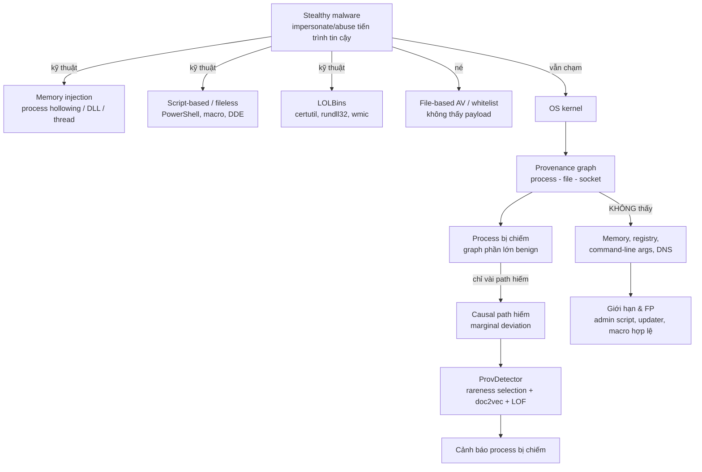

# R21 — Hunting stealthy malware bằng data provenance

> Research synthesis cho đồ án NT230 – Cơ chế hoạt động của mã độc, lớp NT230.R11.ANTN, Học kỳ I 2026–2027.
> Đề tài R21 (Research Track), file đề `docs/source/NT230-FinaL-topics-final-v22.sept2026.xlsm`, sheet "Research Track", dòng 25.
> Paper neo: **You Are What You Do: Hunting Stealthy Malware via Data Provenance Analysis** — hệ thống **ProvDetector**.
> **Kết quả verify venue: paper thật là NDSS 2020, KHÔNG phải NDSS 2025 như file đề ghi.** Chi tiết ở §3.

## 0. Executive summary

- **Đề tài:** R21 — "Hunting stealthy malware bằng data provenance". File đề ghi venue "NDSS 2025" và cột năm "2025", nhưng URL dẫn tới paper *You Are What You Do* của Wang et al., thực chất là **NDSS 2020** (DOI `10.14722/ndss.2020.24167`). Đây chính là paper phải tái lập (đã verify, §3.1); không tồn tại paper NDSS 2025 cùng title [SUY LUẬN dựa trên NDSS 2020 page + DOI; xem §3.1].
- **Intuition 1 câu:** stealthy malware có thể giả mạo/chiếm tiến trình tin cậy để ẩn payload (không file, chỉ RAM), nhưng hành vi độc vẫn phải chạm vào OS — nên vết để lại trong **provenance graph** (process–file–socket) vẫn lộ ra dưới dạng những **causal path hiếm** lệch khỏi hành vi bình thường của chương trình bị chiếm.
- **Câu hỏi nghiên cứu của đồ án (đo được):**
  1. **RQ1 (độ hiệu quả):** Pipeline path-selection → embedding → novelty detection tái lập trên trace công bố/workload mô phỏng đạt Precision/Recall/F1/FPR bao nhiêu khi phân biệt process instance bị chiếm (stealthy) với benign, so với các số của ProvDetector (path-level F1 0.974, graph-level F1 0.978)?
  2. **RQ2 (tín hiệu nào phân biệt được):** Trong các chiều *lineage* (parent–child, exec chain), *tần suất* (regularity/rareness của event và path), *chuỗi hoạt động* (causal path n-hop) và *mức nhiễu* (số path benign lẫn vào graph của tiến trình bị chiếm), chiều nào đóng góp nhiều nhất cho khả năng tách biệt? (ablation: bỏ path selection / đổi K / thêm nhiễu)
  3. **RQ3 (lỗi và chi phí):** False positive đến từ đâu (admin script, updater, installer, browser download…), error taxonomy là gì, và overhead (storage/CPU) khi chạy pipeline ở quy mô lab là bao nhiêu?
  4. **RQ4 (giới hạn):** Kết quả suy biến thế nào khi thiếu telemetry (memory, registry), khi workload drift, khi bị mimicry, và khi giả định "benign profile sạch" không còn đúng?
- **Phương án tái lập khuyến nghị (chốt, xem §5.4 & §6):** fidelity trung bình — **ingest public provenance trace: dataset chính PKU-ASAL/Simulated-Data (~350 MB, Windows ETW + Ubuntu Sysdig, 5 kịch bản APT có ground truth ATT&CK), kiểm chứng chéo bằng ProvNinja sample-enterprise-data (đúng định dạng causal paragraph + feature vector của paper), tự build pipeline rareness path selection + doc2vec(PV-DM) + LOF**, với 2 baseline bắt buộc (rule "UI process không spawn script interpreter" và whole-graph/frequency-only) và đối chiếu metric với paper. Phương án B: ATLAS (~733 MB) hoặc DARPA TC E3 THEIA run 1r (~4.8 GB) qua mirror.
- **Điểm mạnh lớn nhất:** paper mô tả đầy đủ thuật toán từng stage (công thức regularity score, K longest paths, PV-DM, LOF, threshold), có bảng baselines chi tiết để đối chiếu, và tồn tại ≥3 re-implementation mã nguồn mở có thể tham khảo (§3.7).
- **Rủi ro lớn nhất:** enterprise dataset của paper (306 hosts Windows, 3 tháng) **không public** → **không thể claim "tái lập F1=0.974"**; mọi số của đồ án là kết quả trên dữ liệu khác và phải được trình bày tách bạch (tái lập thuật toán ≠ tái lập con số). Rủi ro thứ hai: tải DARPA TC trong 2026 có thể khó (dung lượng lớn, link Google Drive), cần phương án B sớm.

## 1. Bối cảnh môn và phạm vi

### 1.1 Research Track vs Dev Track

R21 thuộc **Research Track** của file đề (`docs/source/NT230-FinaL-topics-final-v22.sept2026.xlsm`, sheet "Research Track"). Trọng tâm rubric: **tái lập nghiên cứu, hiểu đúng đối tượng mã độc, xây dựng dataset có kiểm soát (tùy chọn) và phân tích giới hạn của kết quả**.

| Khía cạnh | R21 Research Track | (Không phải) Dev Track |
|---|---|---|
| Mục tiêu | Tái lập data-provenance hunting, hiểu stealthy malware, phân tích giới hạn | PoC evasion 3 biến thể + detector độc lập |
| Sản phẩm | Pipeline + schema + kịch bản lặp lại + baseline + kết quả detection/overhead + case study + phân tích FP + giới hạn | PoC tấn công/né tránh |
| Malware thật | Không bắt buộc; ưu tiên **trace công bố** (DARPA TC, ATLAS, public benchmarks) | Có thể cần chạy mẫu trong lab |
| Dataset mới | **Tùy chọn**, 20–100 traces là đủ, ưu tiên an toàn/tái lập hơn số lượng | Không nhấn mạnh |

Nguồn: ô `G25`, `H25`, `I25` của file đề (Research Track), và sheet "Research Track - Rubric" [2].

### 1.2 Cái R21 yêu cầu vs không yêu cầu

**Yêu cầu (ô `H25` file đề):** mã thu thập/chuẩn hóa provenance; schema; kịch bản có thể lặp lại; baseline; kết quả detection/overhead; case study trace giải thích được; đánh giá false positives từ ứng dụng bình thường; nêu giới hạn do thiếu telemetry, privacy, workload drift và giả định về stealth.

**Yêu cầu hướng thực nghiệm (ô `G25`):** so sánh stealthy malware với benign theo **lineage, tần suất, chuỗi hoạt động và mức nhiễu**; phân tích hành động nào tạo tín hiệu phân biệt được.

**Không yêu cầu:** PoC evasion 3 biến thể, detector production, malware thật bắt buộc, dataset mới bắt buộc (ô `I25`).

**ML/DL bắt buộc thêm (rubric):** error analysis + nêu trường hợp hệ thống chạy không tốt; điểm số mô hình không thay thế việc hiểu đối tượng mã độc [2].

### 1.3 An toàn / ethics / legal

Trích ràng buộc an toàn áp dụng cả Research Track [2]:

- Chỉ lab cô lập / VM snapshot-rollback / container.
- Không payload phá hoại, không C2 Internet, không credential theft, không exfiltration, không persistence ngoài phạm vi, không phát tán mẫu, không vô hiệu hóa bảo vệ trên máy thật.
- Marker/workload mô phỏng phải vô hại; **ưu tiên trace công bố** hơn tự chạy malware.
- Không đưa mẫu nguy hiểm lên nơi công khai.
- **Vi phạm an toàn có thể không công nhận kết quả dù kỹ thuật cao** (rubric hạng mục 5) [2].

Hệ quả thiết kế cho đồ án: mọi "malicious signal" trong lab được tạo bằng **kịch bản mô phỏng vô hại** (PowerShell marker script cục bộ, command-line chain giả lập, file marker), hoặc lấy từ **trace công bố có nhãn ground truth**. Không tải/chạy mẫu malware thật; danh sách MD5 malware của paper (`share-we/malware`) chỉ dùng để **phân tích metadata** (family/anti-VM/anti-debug), không tải mẫu.

## 2. Đối tượng mã độc (hạng mục rubric 1 — 2.0 điểm)

### 2.1 Stealthy malware là gì

Theo paper [1, §II-A], "stealthy malware" = malware **giả mạo (impersonate) hoặc lạm dụng (abuse) tiến trình/công cụ tin cậy** có sẵn trên host để ẩn payload và kéo dài hiện diện, thay vì thả binary riêng xuống đĩa. Động lực: né file-based AV/static signature, né application whitelist. Report được paper trích dẫn: stealthy attack chiếm ~35% các cuộc tấn công, tăng 364% trong nửa đầu 2019, và có khả năng thành công cao gấp 10 lần tấn công truyền thống [1, §I].

Ba nhóm kỹ thuật impersonation chính (paper phân loại) [1, §II-A]:

1. **Memory code injection** — nạp mã độc vào vùng nhớ tiến trình hợp pháp: remote thread injection, reflective DLL injection, portable executable injection, **process hollowing**, shim-based DLL injection. Thường nhắm tiến trình hệ thống sống lâu (svchost.exe) hoặc app giữ dữ liệu giá trị (browser).
2. **Script-based attacks (fileless)** — nhúng script vào tài liệu Office (macro, DDE), chạy payload qua PowerShell/.NET ngay trên bộ nhớ, không để lại file. Ví dụ kill chain Fig. 1 của paper: phishing email → Word doc → người dùng bật DDE → `DDEAUTO` invoke `cmd.exe` → `powershell.exe` tải+chạy `0.ps1` từ Dropbox → nạp module Empire → backdoor mã hóa về attacker server. Toàn bộ script obfuscated và chỉ tồn tại trong RAM [1, Fig. 1; 3].
3. **Vulnerability exploits** — lợi dụng lỗ hổng app tin cậy để chiếm quyền thực thi (vd CVE-2019-0541 trong Internet Explorer) [1, §II-A].

Ngoài ra paper nhấn mạnh chiến lược **living off the land**: dùng dual-use tools có sẵn (PowerShell, WMIC, certutil, rundll32) mà admin dùng hợp lệ nên không thể chặn trắng-đen [1, §II-A]. "Fileless" không tuyệt đối nghĩa là không có file — mà là giảm tối đa dấu chân trên filesystem, lưu payload ở network buffer, registry, service config [1, §I].

### 2.2 Mục tiêu attacker, điều kiện kích hoạt, hành vi trên OS

- **Mục tiêu:** xâm nhập lâu dài (prolong presence), duy trì remote access (backdoor), exfiltrate dữ liệu nhạy cảm, hoặc cripple máy [1, §III]. Ví dụ thực chiến trong paper: "DrownAuto Certutil Macro Dropper" (một phần APT28) — macro Excel embed payload base64, dùng `certutil.exe` decode thành exe rồi `rundll32.exe` gọi về C2 [1, §VI-C1].
- **Điều kiện kích hoạt:** thường bắt đầu từ **user execution** (mở doc/phishing) hoặc lỗ hổng; sau đó chain tự chạy trong memory (DDE → cmd → PowerShell). Một số mẫu có **anti-VM/anti-debug**: đổi hành vi khi phát hiện sandbox (26% mẫu của paper là anti-VM) [1, §VII].
- **Hành vi quan sát được trên OS (bề mặt provenance):** spawn tiến trình bất thường từ tiến trình tin cậy (winword.exe → cmd.exe → powershell.exe), tiến trình hệ thống đọc/ghi file nhạy cảm, tool hệ thống (certutil/rundll32/mshta/regsvr32/wmic) thực hiện chuỗi hành động lạ, kết nối socket ra địa chỉ ngoài [1, Fig. 2b].

### 2.3 Bề mặt quan sát: cái provenance có và KHÔNG có

ProvDetector chỉ mô hình **3 loại entity: process, file, socket** và 6 quan hệ (Bảng I của paper) [1, §IV-A]:

| Entity | Thuộc tính (paper) | Quan hệ có thể là src→dst |
|---|---|---|
| Process | executable path, PID, host name | start/end process khác; read/write/execute file; read/write socket |
| File | file path, host name | (chỉ làm dst) |
| Socket | src IP, src port, dst IP, dst port | (chỉ làm dst) |

Quy tắc quan trọng: **chỉ process mới là source của event** [1, §IV-A]. Quan hệ: `Start`/`End` (process→process), `Read`/`Write`/`Execute` (process→file), `Read`/`Write` (process→socket).

**KHÔNG có trong provenance model của paper:**
- **Memory** — bản thân hành vi injection (ghi vào RAM tiến trình khác) KHÔNG xuất hiện như một edge; nó chỉ lộ gián tiếp qua hành vi của process bị nhiễm (vd winword spawn cmd) [1, §I; SUY LUẬN từ định nghĩa entity].
- **Registry** — paper nhắc registry như nơi fileless malware giấu payload (motivation), nhưng **không đưa registry vào schema entity/edge** [1, §I vs §IV-A].
- **Command-line arguments** — không nằm trong bảng thuộc tính; paper chỉ dùng executable path làm nhãn process [1, Table I]. Đây là hạn chế lớn: hai lần chạy cùng exe với args khác nhau (vd `certutil -urlcache -f`) trông giống nhau trong graph trừ khi args được log riêng [SUY LUẬN].
- **DNS queries, IPC, shared memory, side channels** — ngoài phạm vi (paper loại implicit flow khỏi threat model) [1, §III].

### 2.4 Stealthy vs noisy malware trên provenance

| | Noisy/traditional malware | Stealthy malware |
|---|---|---|
| Dấu chân file | Drop binary xuống đĩa, tạo process riêng | Gần như không tạo file mới; payload trong RAM/registry/script |
| Process | Process mới mang tên lạ → dễ phát hiện bằng signature/whitelist | Chạy *bên trong* process tin cậy (svchost, winword, IE) |
| Trên provenance graph | Subgraph rõ ràng tách biệt (process lạ + file lạ) | Chỉ vài path hiếm lẫn vào graph lớn toàn hành vi bình thường → "marginal deviation" (challenge C1 của paper) [1, §I] |
| Tỷ lệ path lạ | Phần lớn graph bất thường | Paper đo: **~70% path của tiến trình bị chiếm vẫn không phân biệt được với benign** [1, §VI-C2] |

Hệ quả: whole-graph embedding "chìm" tín hiệu độc trong nhiễu benign — đây là lý do paper chọn path-level feature [1, §VI-C2].

### 2.5 Điểm gây nhầm lẫn (FP cổ điển)

Các hành vi benign trông giống "hành vi lạ" — nguồn FP chính của mọi detector dựa trên rareness:

1. **Admin script/scheduled task:** admin dùng PowerShell/WMI để quản trị (vd `powershell.exe -File backup.ps1` từ Task Scheduler) — giống hệt chuỗi LOLBin của attacker.
2. **Software update/installer:** msiexec, jusched (Java Update Scheduler), maintservice (Firefox Updater) spawn process con, tải file, ghi registry — paper coi 23 program này là *mục tiêu giám sát*, vì chính chúng cũng là victim của stealthy malware [1, Table II].
3. **Compiler/toolchain:** cvtres, cscript, wmic chạy hợp lệ trong build/automation.
4. **Browser download-and-open:** firefox/iexplore tải file rồi spawn app liên kết (word, reader) — chain "browser → download → execute" rất giống ingress+execute của attack.
5. **Macro hợp lệ:** doanh nghiệp dùng Word/Excel macro nội bộ thật.

Paper minh họa chính xác FP kiểu này qua heuristic "UI-heavy program không được spawn script": recall của rule này gần **0 (0.07)** vì attacker dùng nhiều đường khác (Java, hijack notepad) trong khi benign admin cũng spawn script [1, §VI-B1].

### 2.6 Bảng TTP → sự kiện provenance kỳ vọng

| TTP (MITRE ATT&CK) | Hành vi | Node/edge kỳ vọng trong provenance | Tín hiệu phân biệt | Nguyên nhân FP |
|---|---|---|---|---|
| T1059 Command and Scripting Interpreter (PowerShell) | Script chạy từ doc/process khác | `winword.exe -start-> cmd.exe -start-> powershell.exe` | Path "UI app → shell → script" hiếm | Admin script, CI/CD script |
| T1055 Process Injection (gồm T1055.012 Process Hollowing — trước đây là T1093) | Nạp mã vào process khác | Không có edge mới (RAM); lộ qua hành vi của process nạn nhân sau thời điểm nhiễm | Process tin cậy bắt đầu chuỗi hành vi mới (spawn/read/write lạ) | App tự cập nhật, plugin load |
| T1218 System Binary Proxy Execution (rundll32 T1218.011 / mshta T1218.005 / regsvr32 T1218.010) | Tool hệ thống thực thi payload | `excel.exe -start-> certutil.exe -write-> *.exe`, `certutil.exe -start-> rundll32.exe -write-> socket` | Chain qua LOLBin + file mới + socket ngoài | Download hợp lệ, install |
| T1027 Obfuscated Files or Information | Payload base64/obfuscated | `certutil.exe -read-> file-base64 -write-> exe` | Sequence decode→execute | Encode hợp lệ (backup, update) |
| T1047 Windows Management Instrumentation | WMI chạy process từ xa | `wmiprvse.exe -start-> powershell.exe/cmd.exe` | wmiprvse spawn shell hiếm | SCCM/admin remote management |
| T1105 Ingress Tool Transfer | Tải công cụ về | `powershell.exe -write-> socket (external)` | Tool hệ thống kết nối ngoài bất thường | Updater, telemetry |
| T1204 User Execution | Mở doc độc | `winword.exe -read-> *.doc` rồi spawn chain | Chain doc → shell → network | Macro hợp lệ |
| T1564/T1036 Hide Artifacts/Masquerading | Đổi tên giả process hợp lệ | process với exe path giống tool hệ thống nhưng ở thư mục lạ | Path hiếm (vd `C:\Temp\svchost.exe`) — lưu ý paper abstract path nên thư mục lạ vẫn còn | App portable, shadow copy |
| T1574 Hijack Execution Flow (DLL search order…) | Đặt DLL giả cạnh app | `process -read-> *.dll` (path lạ) | DLL load từ vị trí bất thường | Plugin hợp lệ |

Nguồn: mapping TTP→provenance là [SUY LUẬN] của nhóm từ định nghĩa entity/edge của paper [1, §IV-A] + MITRE ATT&CK (ID đã verify qua attack.mitre.org: T1059.001, T1055/T1055.001/.003/.012, T1218/.005/.010/.011, T1027, T1047, T1036, T1564, T1574, T1105, T1204). Lưu ý: `certutil.exe` trong ATT&CK là Software **S0160** (không phải sub-technique của T1218), map sang T1105 (tải payload), T1140 (decode file), T1560.001 (encode), T1553.004 (cài root CA). Process Hollowing trước đây là **T1093**, đã bị revoke từ ATT&CK v7 và gộp thành **T1055.012**. Ví dụ DrownAuto/certutil chain lấy nguyên văn từ paper Fig. 7 [1, §VI-C1].

### 2.7 Concept map



### 2.8 Threat model (theo paper §III)

- **Đối tượng trong phạm vi:** malware giả mạo/lạm dụng tool hợp pháp (impersonation: injection, script, exploit), hoặc bản độc của app tin cậy do người dùng cài nhầm.
- **Ngoài phạm vi:** traditional malware tự thả binary riêng xuống đĩa để chạy payload [1, §III].
- **Giả định (assumptions):**
  - OS + provenance tracker nằm trong TCB; **attacker không thể sửa/xóa provenance record** (log integrity — orthogonal problem, có giải pháp riêng như Custos) [1, §III].
  - **Không xét implicit flow / side channel** bỏ qua system-call interface (tracker không bắt được) [1, §III].
  - Mỗi program được giám sát **có sẵn benign provenance data** để dựng profile bình thường [1, §III].
- **Attacker capability:** attacker chọn được kỹ thuật impersonation tùy ý, obfuscate payload, có thể mimicry hành vi benign (paper đo sức chống chịu: trung bình phải sửa ~5 node trong path mới "giống" benign) [1, §VI-C4].

### 2.9 Định nghĩa nhãn (label book)

| Nhãn | Định nghĩa (dùng cho đồ án) | Ví dụ |
|---|---|---|
| **Benign path** | Path xuất hiện trong graph của process instance benign, phổ biến/quen thuộc với profile chương trình | `winword.exe -write-> *.doc` |
| **Rare-but-benign** | Path hiếm nhưng thuộc hành vi hợp lệ (admin script, update) — nguồn FP chính | `wmic.exe -start-> cmd.exe /c backup` |
| **Stealthy-malicious** | Path hiếm thuộc chuỗi tấn công trong trace có ground truth / kịch bản mô phỏng | `winword.exe -start-> cmd.exe -start-> powershell.exe -write-> socket(ext)` |
| **Missing-telemetry** | Hành vi tấn công không lộ trên provenance (memory-only, registry-only, side channel) — không thể phát hiện về nguyên tắc | injection thuần không spawn/IO; exfil qua kênh covert |

Nguồn: định nghĩa benign/malicious theo paper [1, §IV-B]; phân loại 4 nhãn trên là thiết kế của đồ án để phục vụ error analysis (rubric hạng mục 4 yêu cầu error taxonomy).

## 3. Paper neo (ProvDetector) — đọc PDF đầy đủ

### 3.1 Verify năm/venue/system (mâu thuẫn với file đề)

| Trường | Giá trị verify |
|---|---|
| Title | You Are What You Do: Hunting Stealthy Malware via Data Provenance Analysis |
| System | **ProvDetector** (viết hoa PROVDETECTOR trong paper) |
| Venue thật | **NDSS 2020** — in trực tiếp trên trang 1 của PDF: "Network and Distributed Systems Security (NDSS) Symposium 2020, 23–26 February 2020, San Diego, CA, USA. ISBN 1-891562-61-4. https://dx.doi.org/10.14722/ndss.2020.24167" |
| Authors | Qi Wang, Wajih Ul Hassan, Ding Li, Kangkook Jee, Xiao Yu, Kexuan Zou, Junghwan Rhee, Zhengzhang Chen, Wei Cheng, Carl A. Gunter, Haifeng Chen (UIUC; NEC Laboratories America; UT Dallas) |
| DOI | `10.14722/ndss.2020.24167` |
| File đề ghi | "NDSS 2025", năm "2025" → **SAI** (sai 5 năm). URL trong đề trỏ đúng paper NDSS 2020. |
| Paper khác cùng title tại NDSS 2025? | Không tìm thấy trên trang NDSS 2025 accepted papers → không có paper NDSS 2025 trùng title [SUY LUẬN từ tìm kiếm; liệt kê URL đã kiểm trong §10] |

Đã kiểm tra: (1) trang đầu PDF [1] in đúng venue+DOI; (2) trang NDSS chính thức [3] liệt kê paper cùng author list và link PDF `2020/02/24167-paper.pdf`; (3) slides chính thức [4] ghi "NDSS 2020 Feb 26th, 2020". **Nhóm sẽ làm việc trên paper NDSS 2020 này** và ghi chú mâu thuẫn này vào báo cáo (rubric hạng mục 5 thưởng tính trung thực; đề file cột "Bài báo" dùng tên nguyên bản nên không xung đột).

### 3.2 Problem statement và intuition "You Are What You Do"

- **Vấn đề:** stealthy malware giả mạo tiến trình tin cậy → AV/static/behavioral signature không phân biệt được; cần defense (1) không dựa vào file-level indicator, (2) phát hiện hành vi bất thường của chính program tin cậy, (3) nhẹ đủ để chạy từng host [1, §I].
- **Intuition:** dù malware ẩn vào process benign, hành vi độc vẫn tương tác với OS và bị kernel-level provenance ghi lại. "You Are What You Do" = nhận dạng process qua **hành vi** (graph) chứ không qua danh tính/nhị phân. Dùng anomaly detection huấn luyện chỉ trên benign data → bắt được cả unknown/zero-day [1, §V-A].
- **Formal:** program A có n benign instance với graph {G1..Gn}; cho instance mới p, quyết định G(p) benign hay malicious (process bị chiếm/abused) [1, §IV-B].

### 3.3 Kiến trúc từng stage

```mermaid
flowchart LR
    subgraph S1[1. Graph Building]
        DB[(Provenance DB<br/>ETW/audit, PostgreSQL)] --> GB[Build G(p)<br/>node: process/file/socket<br/>edge: src,dst,rel,time]
    end
    subgraph S2[2. Representation Extraction]
        GB --> PS[Regularity score từng edge<br/>R(e)= H(e)/H × OUT(src) × IN(dst)]
        PS --> TOP[Top-K path hiếm nhất<br/>K longest path trên DAG<br/>Eppstein algorithm, K=20]
    end
    subgraph S3[3. Embedding]
        TOP --> SENT[Path → câu: node là noun, edge là verb]
        SENT --> DV[PV-DM doc2vec<br/>100-dim, gensim, chỉ train trên benign]
    end
    subgraph S4[4. Anomaly Detection]
        DV --> LOF[LOF novelty detection<br/>scikit-learn]
        LOF --> TH[≥ t path bất thường<br/>→ graph malicious, t=3..4]
    end
```

Chi tiết từng stage (theo [1, §V]):

- **Graph Building (§V-B):** từ DB, dựng G(p) = <V,E> xuất phát từ node process p, thêm mọi edge có src hoặc dst đã thuộc V (mở rộng tới khi đóng). Node gắn nhãn thuộc tính, edge gắn nhãn quan hệ + timestamp.
- **Representation Extraction (§V-C):** định nghĩa **causal path** = dãy event có thứ tự `{e1..en}` với `e_i.dst == e_{i+1}.src` và `e_i.time < e_{i+1}.time` (ràng buộc thời gian chống vòng lặp vô hạn). Loại host/PID khỏi node để biểu diễn khái quát hóa.
  - **Rareness-based path selection (§V-C1):** mượn *regularity score* của NoDoze [9]: với event e = src→dst,
    `R(e) = |H(e)|/|H| × OUT(src) × IN(dst)` (công thức 1),
    trong đó H(e) = tập host có event e, H = mọi host; IN/OUT của node v tính bằng tỷ lệ **stable windows**: chia training data thành n time windows; window "in-stable" nếu không có in-edge mới của v, "out-stable" nếu không có out-edge mới. `IN(v) = |T_in0|/|T|`, `OUT(v) = |T_out0|/|T|`. Path regularity `R(π) = ∏ R(e_i)`.
  - Chọn **top-K path có R thấp nhất** = K longest path trong đồ thị có trọng số `W(e) = log2 R(e)` (cộng pseudo source/sink, đổi sang DAG bằng cách tách mỗi node theo thứ tự thời gian của in/out edges để khử chu trình), giải bằng **thuật toán Eppstein** [8] (bài báo trích dẫn cite số 44 của nó). K=20.
- **Embedding (§V-D):** path → câu "Process:winword.exe write File:t1.txt read by Process:outlook.exe write Socket:168.x.x.x". Dùng **PV-DM** của doc2vec [6], tự giám sát, chỉ cần benign data; kích thước vector **100** (mặc định gensim). Giữ thứ tự từ (word order) — cmd→winword benign còn winword→cmd thường malicious.
- **Anomaly Detection (§V-E):** **LOF** [7] — không giả định phân phối, phù hợp multi-cluster/multi-density của workload. Quyết định cuối: **threshold t** — nếu ≥ t path bị dự đoán malicious thì graph malicious; hỗ trợ early stop (chỉ cần chọn top t thay vì K path).
- **Implementation (§V-F):** collector dùng **Windows ETW** + **Linux Audit framework**, lưu **PostgreSQL**; graph builder + path selection ~15K dòng Java (theo mô hình King & Chen [18]); embedding + detection bằng Python (gensim [10], scikit-learn LOF). Preprocessing: **path abstraction** (`C:/USERS/USER_NAME/DESKTOP/PAPER.DOC` → `*:/USERS/*/DESKTOP/PAPER.DOC`) và **socket abstraction** (bỏ địa chỉ nội bộ: bỏ src của outgoing, dst của incoming) [1, §V-F].

### 3.4 Vì sao whole-graph embedding thất bại với stealthy

Paper đo: ~70% path chọn ngẫu nhiên từ graph của process bị chiếm **không** bị detector coi là malicious (vì chúng sinh ra từ phần benign của process). graph2vec (embed toàn graph) đạt recall 0.452, F1 0.601 — thấp hơn cả ngưỡng có nghĩa [1, §VI-C2, Table IV]. t-SNE (Fig. 8 vs Fig. 9) cho thấy path ngẫu nhiên của graph malicious trộn lẫn với benign, trong khi top-20 rarest path của graph malicious tách hẳn thành cụm riêng [1, §VI-C3].

### 3.5 Dataset, protocol, metric, baselines, số liệu

**Dataset [1, §VI-A]:**
- Benign: **306 Windows hosts** trong enterprise thật, thu **3 tháng**, PostgreSQL. Chọn **23 target programs** (IE, Word, Excel, certutil, cmd, wmic, mspaint, notepad, rar, firefox, javaw, spoolsv, wget, wmplayer… — Bảng II).
- Malicious: ~**15,000 mẫu** từ VirusShare/VirusSign chạy trong **Cuckoo sandbox** cùng cấu hình OS/app như enterprise; giữ lại các mẫu có hành vi được kích hoạt, xác định **23 victim programs** trùng với 23 program trên. Mỗi program: **250 benign + 50 malicious instances**; 50 malicious = 50 mẫu malware *khác nhau*.
- Tổng đánh giá: **1,150 malware** (23×50) + 1,150 benign test; 189 family theo AVClass; 298 anti-VM, 238 anti-debug (theo VirusTotal/Tencent HABO; §VII ghi 289 = 26% anti-VM — có lệch nhỏ giữa hai chỗ trong chính paper, ghi nhận nguyên trạng).
- **Chống bias sandbox:** với graph malicious chỉ giữ sub-graph **sau khi payload được nạp** (bỏ event của Cuckoo agent/payload gốc); kiểm tra phân phối embedding của benign workload trong Cuckoo khớp training data [1, §VI-A].

**Protocol:** anomaly detection → train chỉ trên benign: **200 benign train** / **50 benign + 50 malicious test** cho mỗi program. Path-level đánh giá từng path; graph-level dùng threshold t.

**Metric:** Precision / Recall / F1 (path-level lẫn graph-level).

**Kết quả chính (Bảng II, Fig. 5):**

| Mức | Precision | Recall | F1 |
|---|---|---|---|
| Path-level (avg 23 programs) | 0.959 | 0.991 | **0.974** |
| Graph-level, t=3 | 0.957 | 1 | 0.978 |
| Graph-level, t=4 | 0.995 | 1 | 0.997 (slides) |

**Baselines (để đối chiếu trong đồ án):**

| Baseline | Kết quả | Nguồn |
|---|---|---|
| Blacklist heuristic ("UI program không spawn script") | recall ≈ **0.07** | [1, §VI-B1] |
| Whitelist (event xuất hiện > p% benign instances) | best F1 **0.78** (p=3%) | [1, Fig. 6] |
| Anomaly score thuần (regularity score làm detector) | best F1 **0.50** (85th percentile) | [1, Table III] |
| graph2vec (embed toàn graph) | P 0.899 / R 0.452 / F1 **0.601** | [1, Table IV] |
| Path Nodes Averaging (word2vec node, trung bình theo path) | P 0.961 / R 0.890 / F1 **0.924** | [1, Table IV] |
| One-Class SVM thay LOF | F1 **0.739** | [1, Table V] |
| Isolation Forest thay LOF | F1 **0.627** | [1, Table V] |
| Robust Covariance (elliptic envelope) thay LOF | F1 **0.558** | [1, Table V] |

**Runtime [1, §VI-D]:** training (một lần/program): build graph + chọn top-20 path ≈ 7s; doc2vec ≈ 94s (30k paths, dim 100, 100 epochs); LOF ≈ 39s. Detection: build graph ≈ 5s + chọn path ≈ 2s; embed 1ms/path; predict 0.06ms/vector → tổng ≈ 7s/instance. Ước lượng enterprise: 22.7 instance/host/3 tháng cho 23 program; 100 hosts × 30 programs → ~5.7h/ngày nếu đơn luồng.

### 3.6 Interpretability

- Paper dùng **LIME** tìm "KEY nodes": node có ảnh hưởng nhất tới quyết định. Kết quả: không tồn tại tập KEY node dùng chung cho hầu hết path — 50% malicious path có KEY node riêng, trung bình 1 KEY node chỉ ảnh hưởng ~3.1 path → model học **path-level feature**, không chỉ memorized node đơn lẻ [1, Appendix C2].
- Mimicry robustness: editing distance trung bình giữa malicious path và benign path ≈ **5 node** — attacker phải sửa/add/delete ~5 system object để giả benign [1, §VI-C4].

### 3.7 Limitation do chính authors thừa nhận

1. **Offline only** — quét DB theo chu kỳ; online cần in-memory graph DB + incremental K-longest-path (để future work) [1, §VII].
2. **Đánh giá chỉ trên Windows** (dù có collector Linux); không phụ thuộc tính năng riêng Windows [1, §VII].
3. **Model đơn giản** (doc2vec + LOF); LSTM/GCN/one-class NN có thể tốt hơn nhưng đắt hơn [1, §VII].
4. **Mimicry attacks** — chưa phòng thủ chủ động, mới đo effort (~5 node) [1, §VII].
5. **Anti-analysis malware** — 26% mẫu anti-VM có thể đổi hành vi trong sandbox; trên bare metal hành vi sẽ "cùng hoặc độc hơn" nên vẫn bắt được [1, §VII].
6. **Benign dataset có thể ô nhiễm** (không đảm bảo 100% sạch) [1, §VII].

### 3.8 Artifact công khai

- **Code chính thức: KHÔNG có** (không release; paper chỉ footnote repo hash) [1, footnote §VI-A].
- **Repo duy nhất của authors:** `github.com/share-we/malware` — chứa `malware_list.csv/pdf/txt` (MD5, anti-VM/anti-debug, AVClass label của 1,150 mẫu) — **chỉ metadata, không có trace, không có code**.
- **Re-implementations bên thứ ba (có thể tham khảo, sẽ verify license ở §5):**
  - `syssec-utd/provninja` — `intrusion-detection-system/path-based/provdetector.py` (pipeline path-based + LOF), từ lab của co-author Kangkook Jee (UT Dallas), công bố kèm ProvNinja (USENIX Security 2023).
  - `PKU-ASAL/Simulated-Data` — thư mục `ProvDetector/` (NODLINK NDSS 2024): prototype path extraction + embedding + anomaly detection.
  - `gyselph/eagle-eye` — script baseline ProvDetector (EagleEye/eCrime 2024).
- **Video talk:** https://www.youtube.com/watch?v=cmenLqP4nWc [5]. **Slides:** [4]. **PDF:** [1].

### 3.9 Gap giữa paper và đồ án sinh viên

| Khía cạnh | Paper | Đồ án (thực tế) |
|---|---|---|
| Data benign | 306 hosts × 3 tháng enterprise (không public) | Trace công bố (DARPA TC/ATLAS) hoặc lab workload vài giờ–vài ngày |
| Data malicious | 1,150 malware thật trong Cuckoo | Trace attack công bố có ground truth / kịch bản mô phỏng vô hại (không chạy malware) |
| Compute | Desktop i7 + DB trung tâm | 1–2 laptop/VM; dataset nhỏ hơn nhiều bậc |
| Collector | ETW + audit + PostgreSQL (15K dòng Java) | Ingest trace có sẵn (parquet/json/log) → giảm phạm vi thu thập |
| Khả năng claim | F1 0.974 trên data riêng | **Không claim tái lập con số**; chỉ tái lập pipeline + so sánh định tính/định lượng trên data thay thế |

## 4. Related work có chọn lọc

Tất cả thông tin dưới đây đã được verify qua trang chính thức (USENIX/NDSS/IEEE/Elsevier/arXiv/GitHub) tháng 10/2026; URL trong từng mục.

### 4.1 Bảng tổng

| Paper | Năm / Venue | Input | Method | Phát hiện gì | Khác ProvDetector thế nào |
|---|---|---|---|---|---|
| HOLMES [29] | IEEE S&P 2019 | Audit logs (DARPA TC CDM) | Map event→TTP (ATT&CK), High-Level Scenario Graph, điểm theo kill-chain | APT đa giai đoạn (real-time) | Rule/TTP-based, cần định nghĩa trước; ProvDetector unsupervised, không cần signature |
| UNICORN [30] | NDSS 2020 | Whole-system provenance (CamFlow/DARPA TC) | WL subtree kernel + HistoSketch sketch graph + clustering | APT "low-and-slow", zero-day, rootkit | Whole-graph sketch → pha loãng tín hiệu (<0.01% events); ProvDetector tách path để tránh đúng điểm này |
| SIGL [31] | USENIX Security 2021 | Audit log lúc cài phần mềm | Graph LSTM autoencoder, reconstruction error | Installer độc hại, supply chain | Học graph-level trên ranh giới 1 lần cài đặt; ProvDetector path-level trên mọi instance của chương trình |
| SHADEWATCHER [32] | IEEE S&P 2022 | Audit records | Knowledge graph + GNN (KGAT), edge-level prediction | APT, zero-day, edge-level anomaly | GNN + KG nặng, cần side-info; ProvDetector nhẹ hơn (doc2vec+LOF), đơn vị là path |
| ATLAS [33] | USENIX Security 2021 | Windows/Linux audit logs | Từ symptom node, LSTM phân loại chuỗi thực thi | Tấn công nhiều bước, LOTL; loại 99% event vô can | Investigation (cần symptom), supervised; ProvDetector detection chủ động, unsupervised |
| KAIROS [34] | IEEE S&P 2024 | Streaming provenance (DARPA TC/OpTC) | Temporal GNN (TGN+UniMP), edge-type prediction | APT, zero-day, lateral movement | GNN hiện đại, online; ProvDetector offline, đơn giản hơn, đủ cho mục tiêu stealthy |
| FLASH [35] | IEEE S&P 2024 | Audit logs (DARPA TC) | Word2Vec semantic encoder + GNN contextual encoder + embedding recycling DB | Stealthy APT, LOTL, mimicry | Cùng lab DART (W. U. Hassan đồng tác giả ProvDetector); kế thừa path→sentence nhưng online node-level |
| ThreaTrace [36] | IEEE TIFS 2022 | Audit logs (DARPA TC) | GraphSAGE node embedding + confidence masking | Host threats, zero-day, rootkit | Node-level supervised; ProvDetector path-level unsupervised |
| TAPAS [37] | USENIX Security 2025 | Audit logs (DARPA TC, OpTC) | Task-guided backbone graph segmentation + LSTM-GRU | APT dài ngày, lateral movement | Online segmentation cho graph khổng lồ (nén 1806×); bổ trợ cho khâu chọn path của ProvDetector |
| ProvGOutLiner [38] | Computers & Security 2025 | Provenance graphs (DARPA TC) | Process behavior feature vector + lightweight unsupervised outlier detection | APT, process-level anomaly | Không GNN; triết lý "lightweight" giống ProvDetector, nhưng feature thủ công thay vì embedding path |
| CAPTAIN [39] | NDSS 2025 | Audit logs (DARPA TC E3/E5, OpTC) | Differentiable tag propagation → tinh chỉnh tham số rule bằng gradient; runtime chỉ là rule engine siêu nhẹ | Host intrusion, APT, privilege escalation | PIDS lai rule+gradient; ý tưởng tuning siêu tham số (K, ngưỡng LOF) của ProvDetector có thể học theo |

Các hệ thống thu thập/giảm nhiễu provenance (dùng làm nền, trích từ reference list paper [1] + verify link): **SPADE** (GPL-3.0, collector/middleware OPM/PROV, không có data tấn công [40]); **CamFlow** (NDSS 2017, LSM Linux, W3C PROV-JSON [41]); **Hi-Fi** (ACSAC 2012); **LPM** (USENIX Security 2015); **BEEP** (NDSS 2013), **ProTracer** (NDSS 2016), **LogGC** (CCS 2013), **Winnower** (NDSS 2018) — nhóm chống "dependency explosion"; **PrioTracker** (NDSS 2018) và **NoDoze** (NDSS 2019) — nguồn gốc trực tiếp của *regularity score* mà ProvDetector dùng (NoDoze chỉ xếp hạng alert, không tự học ranh giới benign/malicious — đúng gap ProvDetector lấp) [1, §VIII; 9].

### 4.2 Ý nghĩa từng cụm với R21

- **Cụm path→sentence (ATLAS, FLASH):** xác nhận biểu diễn "causal path như câu văn" là hướng đúng; ProvDetector khác ở chỗ **unsupervised** và không cần symptom node.
- **Cụm whole-graph (UNICORN, KAIROS, ThreaTrace):** cho thấy rủi ro pha loãng tín hiệu khi stealthy malware chỉ chiếm phần rất nhỏ graph — đây chính là justification cho ablation "bỏ path selection" trong đồ án.
- **Cụm rule/lightweight (HOLMES, ProvGOutLiner, CAPTAIN):** là baseline tư duy đối lập — dùng để đặt câu hỏi "path embedding có thực sự cần thiết hay feature đơn giản đã đủ" (đúng yêu cầu ablation của rubric).
- **Cụm segmentation (TAPAS, SIGL):** giải pháp khi graph process quá dài (daemon chạy nhiều ngày) — giới hạn thực tế mà pipeline offline của ProvDetector gặp; đồ án ghi nhận như limitation, không bắt buộc implement.

## 5. Dữ liệu (hạng mục rubric 3 — 2.0 điểm)

### 5.1 Dataset của paper — có lấy được không (2026)?

| Thành phần | Trạng thái |
|---|---|
| Benign enterprise provenance (306 hosts, 3 tháng) | **KHÔNG public** — không có link trong paper/trên trang NDSS [1, §VI-A] |
| Malicious provenance (1,150 mẫu, Cuckoo) | **KHÔNG public** — không release trace, không release code |
| Metadata mẫu (`share-we/malware` [14]) | **CÓ**: `malware_list.csv/pdf/txt` (MD5, anti-VM/anti-debug, AVClass label) — chỉ hash/metadata, **không phải trace** |
| Code | Không có code chính thức; 3 re-implementation (§3.8) |

→ Không thể dùng dataset gốc; **không thể claim tái lập F1 0.974**. Rubric hạng mục 3 sẽ được đáp bằng **phân tích sâu dataset thay thế** (bias, leakage, license, giới hạn) như yêu cầu "nếu không đóng góp dữ liệu".

### 5.2 Ứng viên thay thế (đã verify link + license 10/2026)

| Ứng viên | Nguồn | License | Kích thước | Schema / entity-edge | Nhãn tấn công | Khó parse | Phù hợp stealthy? |
|---|---|---|---|---|---|---|---|
| **PKU-ASAL/Simulated-Data** [27] | GitHub (NODLINK, NDSS 2024) | Research-only MIT | ~350 MB | JSON lines: `host_ip, pid, pcommand, filename, datatype, event_id` + nhãn; thu từ Windows 10/Server 2012 (ETW) + Ubuntu 20.04 (Sysdig) | 5 kịch bản APT (APT29, Sidewinder, FIN6), ground truth A1–A37 kèm ATT&CK | Thấp (JSON) | **Cao** — có Windows, có benign+anomaly, có code ProvDetector tham chiếu trong `ProvDetector/src/` |
| **ProvNinja sample data** [26] | GitHub (syssec-utd, lab của co-author Kangkook Jee) | BSD 3-Clause | ~29 MB | Causal paragraphs CSV (`NOTEPAD.EXE PROC_CREATE JAVA.EXE READ_WRITE 172.16.157.129:443`) + feature vector 100-dim từ Doc2Vec + model LOF pretrained | Enterprise APT mô phỏng (Windows: JAVA/NOTEPAD/EXCEL/OUTLOOK) + adversarial gadgets | Thấp (CSV) | **Cao** — đúng định dạng path của ProvDetector, kèm `provdetector.py` |
| **ATLAS dataset** [33] | GitHub (purseclab/ATLAS) | Apache 2.0 | ~733 MB (raw_logs ~470 MB) | Windows Security events (4688/4663/5156) + Linux auditd + DNS log; node: process/file/ip/domain | 10 kịch bản APT (M1–M6 multi-host, S1–S4 single-host; lấy cảm hứng Carbanak, CozyCar, Equifax, APT29) | Trung bình | **Cao** — nhiều kịch bản LOTL, cả Win+Linux |
| **UNICORN traces** [42] | Harvard Dataverse + `crimson-unicorn` | Data CC0; code GPL-2.0 | ~1–2 GB | CamFlow W3C PROV-JSON (entity: file/inode/pipe/socket; activity: process; edge: used/wasGeneratedBy/…) | Wget-Trojan (125 benign/25 trojan), Shellshock APT SC-2 | Trung bình (PROV-JSON) | **Cao** — trojan supply-chain đúng chất stealthy, nhưng chỉ Linux |
| **DARPA TC E3/E5** [43] | GitHub index + Google Drive (Five Directions) | **Public Domain** | Rất lớn: cả engagement ~300 GB–1 TB; THEIA E3 run 1r ~4.8 GB nén (~45–50 GB JSON) | CDM (Avro/JSON): Subject/FileObject/NetFlowObject/MemoryObject; edges EXECUTE/CLONE/FORK/READ/WRITE/CONNECT/… | Red team APT: Firefox backdoor Drakon, BIND exploit, webshell… kèm `theia1_ground_truth.txt` | Cao (Avro+CDM, JSON lớn) | **Cao nhưng nặng** — chỉ nên lấy 1 file nhỏ qua mirror [44] |
| SPADE [40] / CamFlow [41] | GitHub | GPL-3.0 / GPL-2.0 | — | Collector/middleware, **không kèm dataset tấn công** | Không | — | **Không phù hợp làm dataset** (chỉ là công cụ thu) |

Mirror DARPA TC đang sống (10/2026): threaTrace Google Drive mirror [44] (chứa `ta1-theia-e3-official-1r.json.tar.gz` ~4.8 GB); `FDUDSDE/MAGIC` (graph `.pkl` E3-THEIA tiền xử lý); `ubc-provenance/PIDSMaker` (PostgreSQL dump E3). Link `github.com/ejschreiner/...` đã chết (404) — không dùng.

### 5.3 Bias, leakage, imbalance — phân tích bắt buộc (rubric 3)

- **Leakage theo host/process:** nếu split theo event/path thay vì theo process instance, model sẽ thuộc vẹt path của instance đã thấy ở train → F1 ảo. Bắt buộc split theo instance (đúng cách paper: 200 train / 50 test mỗi program) [1, §VI-A]. Với DARPA TC: cùng host có thể xuất hiện cả train lẫn test nếu là các khoảng thời gian khác nhau — phải dùng temporal split và ghi rõ ranh giới thời gian.
- **Imbalance:** số event benign áp đảo (tỷ lệ tấn công trong trace thường < 0.01–1%); metric phải là P/R/F1 theo class, không dùng accuracy (rubric 4 cấm chỉ báo accuracy).
- **Sandbox/lab bias:** nếu tự thu, phải loại event của agent kịch bản trước payload (đúng cách paper xử lý Cuckoo [1, §VI-A]); kịch bản mô phỏng "sạch" hơn malware thật → kết quả có xu hướng lạc quan, phải ghi threat-to-validity.
- **Label noise của DARPA TC:** ground truth là danh sách UUID sự kiện độc, không phải nhãn từng process → cần quy trình map UUID→path (tài liệu README-E3 hướng dẫn); có thể lệch ranh giới vài event [43].
- **Family/temporal drift:** PKU-ASAL/ATLAS gom nhãn theo kịch bản; nên thử cross-scenario (train benign scenario A, test attack scenario B) để đo generalization — đúng yêu cầu "temporal/cross-family split" của rubric.

### 5.4 Quyết định (chốt, có phương án B)

- **Dataset chính:** **PKU-ASAL/Simulated-Data** — nhẹ (~350 MB), JSON dễ parse, có Windows (khớp paper), có ground truth theo ATT&CK, có sẵn code tham chiếu ProvDetector để đối sánh; license research-only MIT phù hợp đồ án [27].
- **Kiểm chứng chéo (cross-check classifier):** **ProvNinja sample-enterprise-data** — causal paragraphs đúng định dạng paper + feature vector 100-dim + model LOF pretrained của lab co-author [26]. Dùng để sanity-check khâu embed+detect của nhóm.
- **Phương án B (nếu PKU-ASAL/ProvNinja gặp trục trặc hoặc cần cross-dataset):** **ATLAS** (~733 MB, cả Windows+Linux, 10 kịch bản) [33], hoặc **DARPA TC E3 THEIA run 1r** qua mirror threaTrace (~4.8 GB, kèm ground truth) [44] — chọn 1 trong 2 tùy tài nguyên đĩa.
- **Dataset mới (ô I25, tùy chọn):** mặc định **không thu thập malware mới**. Nếu dư thời gian: tự thu **20–40 lab traces Sysmon vô hại có nhãn** (kịch bản marker §8) kèm data card → đóng góp artifact dữ liệu nhỏ, an toàn. Chi phí: 1 VM Windows + 2–3 buổi; lợi ích rubric 3 ở mức khá/giỏi. Quyết định cuối ở task T03.

### 5.5 Data card skeleton (điền ở task T03, file `docs/data-card.md`)

- `dataset_name`, `source_url`, `license`, `downloaded_date`, `checksum` (sha256 các file gốc).
- `collection_environment` (OS, công cụ thu: ETW/Sysdig), `timespan`.
- `schema` (bảng entity/edge/attribute, map sang schema đồ án §6.1).
- `labels` (định nghĩa theo §2.9; ground truth map ATT&CK nếu có).
- `splits` (train/test theo instance; temporal boundary; seed).
- `statistics` (số event/process/path; imbalance ratio; phân bố độ dài path).
- `known_biases` (sandbox, label noise, drift) + `ethics_notes` (privacy: path user, PII; public domain/CC0 không chứa dữ liệu cá nhân thật).

## 6. Pipeline tái lập khả thi

### 6.1 Schema provenance của đồ án

Bám sát schema paper (Bảng I [1]) để đối chiếu được, bổ sung trường cần thiết cho telemetry thực tế:

- **Entity:** `process` (pid, ppid, exe_path, cmdline*, host, start/end time), `file` (path, host), `socket` (src/dst ip, src/dst port, protocol*). (`*` = mở rộng so với paper, đánh dấu [SUY LUẬN] — cmdline cần thiết cho error analysis dù paper không dùng.)
- **Edge (event):** `src, dst, rel, time` với rel ∈ {Start, End, Read, Write, Execute}; chỉ process là src. Bổ sung `host` để chống trộn lẫn host.
- **Normalization:** path abstraction (`*:/USERS/*/...`), socket abstraction (bỏ IP nội bộ), chuẩn hóa file extension (paper nhóm theo type để đo editing distance [1, §VI-C4]); bỏ PID/host khỏi nhãn node khi tạo "câu" path.
- **Định dạng lưu:** event stream dạng JSONL/parquet với `(ts, host, src_entity, src_attrs, dst_entity, dst_attrs, rel)` — một schema dùng cho cả DARPA TC và lab traces sau khi normalize.

### 6.2 Thu thập (nếu lab) vs ingest trace có sẵn

- Ưu tiên **ingest**: dataset chính **PKU-ASAL/Simulated-Data** (JSON lines từ ETW/Sysdig) + **ProvNinja sample-enterprise-data** (causal paragraph CSV) — parser chuẩn hóa về schema §6.1; phương án B **ATLAS** (Windows Security events + Linux auditd) hoặc **DARPA TC E3 THEIA 1r** (CDM JSON, ~4.8 GB qua mirror threaTrace) [§5.2].
- Nếu tự thu lab traces (tùy chọn dataset mới §5.4): Sysmon trên Windows VM (Event ID 1/3/7/11/12/13/14/15/22 → map thành Start/Read/Write/Execute + socket) hoặc `auditd` trên Linux; VM snapshot-rollback; workload vô hại + kịch bản marker.
- Dù ingest hay tự thu: **không chạy malware thật**, không kết nối C2.

### 6.3 Path extraction / rareness scoring — các mức fidelity

| Mức | Làm gì | Chi phí | Khi nào dùng |
|---|---|---|---|
| F1 (tối thiểu) | Enum path độ dài ≤ L (2–4), rareness = tần suất path trong training | Thấp | Kẹt thời gian |
| F2 (khuyến nghị) | Regularity score đúng công thức (1) của paper: tần suất × IN/OUT stability theo time windows; top-K=20 | Trung bình | **Phương án chốt** |
| F3 (cao) | F2 + K longest path trên DAG bằng Eppstein (đúng paper) | Cao | Nếu còn tuần dư |

Lưu ý trung thực: paper nhấn mạnh F2/F3 khác nhau về độ phủ path (NoDoze enumerate mọi path → chậm; paper tối ưu bằng DAG + Eppstein) [1, §V-C1]. Với dataset nhỏ của đồ án, enumerate có giới hạn độ dài vẫn chạy được → F2 là cân bằng hợp lý [SUY LUẬN].

### 6.4 Embedding + detector — các mức fidelity

| Mức | Pipeline | Ghi chú |
|---|---|---|
| F1 (tối thiểu) | Feature thủ công (parent-child, tần suất event, rare single edge) + Isolation Forest | Baseline, không phải tái lập |
| F2 (khuyến nghị) | **PV-DM doc2vec (dim 100, gensim) + LOF (scikit-learn)** — đúng paper | **Phương án chốt** |
| F3 (cao) | F2 + thêm so sánh One-Class SVM / Isolation Forest / RobustCovariance như Bảng V paper | Rẻ (sklearn có sẵn), nên làm nếu thời gian cho phép |

### 6.5 Baselines bắt buộc

1. **Rule/heuristic:** "UI-heavy program không spawn script interpreter" (đúng strawman của paper, recall ≈ 0.07) — chứng minh rule đơn không đủ [1, §VI-B1].
2. **Whole-graph hoặc frequency-only:** (a) graph2vec/whole-graph embedding hoặc (b) whitelist theo % benign instances — để chứng minh path selection quan trọng [1, §VI-B].
3. (Nên có) **anomaly score thuần** — regularity score làm detector trực tiếp (paper: F1 0.50) [1, Table III].

### 6.6 Metric và overhead

- Detection: Precision / Recall / F1 (path-level + graph-level), FPR, confusion matrix.
- Overhead: storage (bytes/event, bytes/hour/host), runtime (thời gian ingest → graph → select → embed → detect mỗi instance), so với con số paper (7s/instance, 94s+39s training) [1, §VI-D].
- Lead-time (nếu trace có timestamp ground truth): khoảng cách từ event tấn công đầu tiên đến lúc phát hiện.

### 6.7 Protocol chống leakage

- **Đơn vị split là process instance / host, KHÔNG phải event hay path**: mọi path của một instance phải nằm cùng một phía (train hoặc test) — nếu không, model "thuộc" path của instance đã thấy [SUY LUẬN từ thiết kế paper: train/test chia theo instance 200/50 [1, §VI-A]].
- Temporal split (train = khoảng thời gian trước, test = sau) để không rò tương lai.
- Không dùng nhãn malicious trong bất kỳ bước nào của training (anomaly detection thuần benign).
- Seed cố định + ghi phiên bản gensim/sklearn/numpy trong env lock.
- Chống bias sandbox nếu tự thu: bỏ mọi event thuộc về agent/kịch bản nạp payload, chỉ giữ hành vi của process bị chiếm (đúng cách paper xử lý Cuckoo bias [1, §VI-A]).

## 7. Thực nghiệm sẽ trả lời gì (hạng mục rubric 4 — 2.5 điểm)

### 7.1 Hypotheses

- **H1 (path selection):** top-K rarest path chứa phần lớn tín hiệu độc; bỏ path selection (dùng whole-graph hoặc path ngẫu nhiên) làm F1 giảm rõ rệt (paper: graph2vec F1 0.601 vs path-level 0.974).
- **H2 (embedding giữ thứ tự):** doc2vec (có word order) > Path Nodes Averaging (mất thứ tự) ở recall (paper: 0.991 vs 0.890).
- **H3 (lineage vs tần suất):** trên lab/trace công bố, đặc trưng lineage (parent–child, exec chain) một mình không đủ; tần suất/rareness trên path n-hop cải thiện P/R; chuỗi (n-hop) phân biệt tốt hơn single-hop (paper: blacklist recall 0.07).
- **H4 (nhiễu):** khi tỷ lệ path benign trong graph của process bị chiếm tăng (tấn công "ít động tĩnh"), precision giữ nhưng recall giảm; threshold t nhạy với mức nhiễu.
- **H5 (FP nguồn):** phần lớn FP rơi vào nhãn rare-but-benign (admin script, updater, installer) — taxonomy sẽ kiểm chứng.

### 7.2 Biến độc lập / phụ thuộc

| Biến độc lập (điều khiển) | Biến phụ thuộc (đo) |
|---|---|
| Lineage: depth/loại parent-child | P/R/F1/FPR |
| Tần suất: ngưỡng rareness, K, tham số p whitelist | P/R/F1/FPR |
| Chuỗi: độ dài path (1–5 hop), có/không thứ tự | P/R/F1/FPR |
| Mức nhiễu: % path benign pha vào graph malicious | P/R/F1 theo mức nhiễu |
| Detector: LOF vs OCSVM vs IF vs RobustCovariance | P/R/F1 |
| Seed / time-window của regularity | variance, CI |

### 7.3 Error taxonomy dự kiến

- **FP–rare-but-benign:** admin/automation script, updater, installer, browser download → đề xuất khử bằng profile theo thời gian/người dùng.
- **FP–abstraction:** path abstraction làm mất ngữ cảnh (vd 2 thư mục khác nghĩa gộp 1) → cùng "câu" cho 2 hành vi khác.
- **FN–missing-telemetry:** memory-only/registry-only/DNS-only → không có edge, không thể thấy (nguyên tắc).
- **FN–mimicry:** path bị sửa gần benign (editing distance < 5).
- **FN–drift:** workload mới (app update) chưa có trong profile → mọi path mới đều "lạ" (vừa gây FP nếu threshold t nhỏ, vừa làm model kém phân biệt).
- **FN–short-trace:** tấn công ít hơn t path lạ → không vượt threshold.

### 7.4 Threats to validity

- **Construct:** "path hiếm" có thực sự đo hành vi độc? (paper chứng minh gián tiếp qua t-SNE + LIME; đồ án phải lặp kiểm tra bằng ablation); nhãn ground truth của trace công bố có chính xác?
- **Internal:** leakage (cùng instance rơi cả train/test), seed, thứ tự chọn K path khi hòa score, sandbox bias khi tự thu.
- **External:** enterprise data (paper) ≠ DARPA/lab data (đồ án) → con số không so sánh trực tiếp được; Windows-only paper vs Linux trace; workload drift theo thời gian.
- **Conclusion:** dataset nhỏ → khoảng tin cậy rộng; dùng seed cố định + báo CI; không suy rộng "ProvDetector đạt F1 0.974" từ kết quả đồ án.

### 7.5 Trường hợp hệ thống chắc chắn kém (bắt buộc với ML)

1. **Rare-but-benign dày đặc** (host chạy nhiều admin script/update): precision sụt mạnh.
2. **Mimicry < 5 node** so với benign path.
3. **Workload drift lớn** (app vừa update bản mới, profile cũ): vừa FP vừa FN.
4. **Tấn công gần như không tạo edge mới** (injection thuần rồi ngủ; exfil qua kênh hợp pháp sẵn có): dưới ngưỡng t.
5. **Trace ngắn/thưa** (mỗi instance vài event): không đủ path để chọn top-K, doc2vec học kém.
6. **Data nhỏ lặp** (nhiều instance giống hệt nhau): mọi path đều "thường xuyên" → không còn gì hiếm để chọn.

## 8. Case study giải thích được (kịch bản vô hại)

> Mục đích: 2–3 case study dùng trong báo cáo để minh họa vì sao detector cảnh báo đúng (TP) hoặc sai (FP) — tất cả kịch bản **vô hại**, không mô tả cách viết malware.

### 8.1 Word → PowerShell marker cục bộ (mô phỏng TP của kiểu DDE/fileless)

Kịch bản: script vô hại mở file `.doc` bằng MS Word, trong doc có macro (tự viết, vô hại) gọi `cmd.exe /c powershell.exe -File C:\marker\hello.ps1`; script chỉ ghi file marker `hello.txt` rồi thoát, không network.

- Graph kỳ vọng: `winword.exe -start-> cmd.exe -start-> powershell.exe -write-> hello.ps1 -write-> hello.txt`.
- Path hiếm: `winword.exe→cmd.exe→powershell.exe` — với profile benign của winword (chỉ read/write doc), path này có regularity rất thấp → LOF báo lạ → TP.
- Ý nghĩa: tái hiện đúng tín hiệu Fig. 2b của paper [1] mà không cần malware thật.

### 8.2 Browser download rồi mở file (FP cổ điển)

Kịch bản: firefox tải `report.pdf` từ server nội bộ rồi người dùng bấm mở → spawn `acrord32.exe`.

- Graph: `firefox.exe -read-> socket(int) -write-> report.pdf -start-> acrord32.exe -read-> report.pdf`.
- Vì sao FP: path `firefox→socket→file→acrord32` hiếm (chỉ khi người dùng chủ động download mở) nhưng hoàn toàn benign → thuộc nhãn rare-but-benign; nếu xuất hiện trong test và LOF báo lạ → FP. Đây chính là loại FP mà rubric 4 yêu cầu phân tích và đề bài (H25) yêu cầu "đánh giá false positives từ ứng dụng bình thường".

### 8.3 Admin scheduled task backup (FP do dual-use tool)

Kịch bản: Task Scheduler chạy `wmic.exe /node:...` hoặc `cmd.exe /c robocopy` để backup nội bộ định kỳ.

- Graph: `svchost.exe(schedule) -start-> wmic.exe -start-> cmd.exe -read/write-> share`.
- Vì sao FP: chuỗi qua LOLBin giống hệt chuỗi tấn công T1047/T1059; chỉ khác ngữ cảnh (thời gian định kỳ, target nội bộ, người dùng admin) mà schema paper không mô hình → detector dựa thuần path sẽ báo lạ. Đây là minh chứng cho "điểm gây nhầm lẫn" ở §2.5 và cơ sở cho đề xuất cải tiến (thêm thuộc tính user/schedule — ngoài phạm vi tái lập).

## 9. An toàn, privacy, ethics

- **Telemetry thiếu:** provenance không thấy memory (bản chất injection), registry (paper không model), command-line args (paper không log), DNS query (chỉ thấy IP socket). Mọi kết luận "không phát hiện được" phải đối chiếu với giới hạn telemetry này — không tuyên bố "malware không tồn tại" khi chỉ là "không thấy trên provenance".
- **Privacy:** path file chứa tên người dùng, tên file có thể chứa PII → bắt buộc path abstraction trước khi lưu/công bố (paper đã làm [1, §V-F]); không đưa trace lab chứa dữ liệu cá nhân thật lên repo công khai; checksum + manifest mọi artifact.
- **Workload drift:** profile học từ dữ liệu cũ lệch khi app/OS cập nhật — phải ghi rõ khoảng thời gian thu và version trong data card.
- **Giả định về stealth vỡ trên lab:** (1) kịch bản mô phỏng "sạch" hơn malware thật (không có anti-VM/anti-debug, không có hành vi nhiễu nền) → kết quả lab có thể *lạc quan hơn* thực tế; (2) ngược lại, workload lab ngắn làm profile nghèo → FP nhiều hơn. Cả hai phải được ghi như threat-to-validity.
- **Ethics/legal:** không tải mẫu malware thật; metadata MD5 (share-we/malware) chỉ dùng để phân tích family distribution; mọi kịch bản marker vô hại; tuân thủ license của DARPA TC (research use) và các trace công bố khác; lab cô lập + snapshot rollback; không công khai payload/script có thể dùng sai mục đích.

## 10. Open questions / việc cần GV xác nhận

1. **Venue:** file đề ghi "NDSS 2025" nhưng paper là NDSS 2020 (DOI 10.14722/ndss.2020.24167). Nhóm mặc định làm theo paper NDSS 2020 (URL đề cho đúng paper này). Cần GV xác nhận có chấp nhận không, hay có nguồn "NDSS 2025" khác nhóm chưa thấy (nhóm đã tìm trang accepted papers NDSS 2025, không có bài trùng title).
2. **Dùng trace công bố có nhãn attack (PKU-ASAL/ProvNinja/ATLAS/DARPA TC) làm "malicious data"** thay vì tự chạy malware — xác nhận đây đúng tinh thần Research Track (nhóm hiểu là đúng theo đề: "trace được công bố hoặc workload mô phỏng").
3. **Phạm vi collect hay chỉ ingest:** nhóm đề xuất ingest-first (parser cho PKU-ASAL/ProvNinja, dự phòng ATLAS/DARPA TC + Sysmon lab). Nếu GV muốn có collector thật, cần thêm 1–2 tuần (Sysmon config + VM lab).
4. **Dataset mới (ô I25, tùy chọn):** nhóm đề xuất KHÔNG thu thập malware mới, thay vào đó nếu dư thời gian sẽ đóng góp "artifact dữ liệu" = bộ lab traces Sysmon tự thu 20–40 kịch bản vô hại có nhãn + data card (an toàn, tái lập được). Cần GV xác nhận hướng này đủ tiêu chí hạng mục 3 hay phải "phân tích sâu dataset gốc" là đủ.
5. **Công cụ/tài nguyên:** được phép dùng VM Windows + Sysmon (license Sysinternals free), gensim/sklearn; không cần GPU.

## 11. Tài liệu tham khảo

1. Q. Wang, W. U. Hassan, D. Li, K. Jee, X. Yu, K. Zou, J. Rhee, Z. Chen, W. Cheng, C. A. Gunter, and H. Chen, "You Are What You Do: Hunting Stealthy Malware via Data Provenance Analysis," in *Proc. NDSS*, San Diego, CA, USA, 2020. DOI: 10.14722/ndss.2020.24167. PDF: https://www.ndss-symposium.org/wp-content/uploads/2020/02/24167-paper.pdf
2. File đề môn: `docs/source/NT230-FinaL-topics-final-v22.sept2026.xlsm`, sheets "Research Track" (dòng 25 = R21) và "Research Track - Rubric" (hạng mục 1–5; ô điểm hạng mục 4 lỗi format serial 46144).
3. Trang NDSS chính thức của paper: https://www.ndss-symposium.org/ndss-paper/you-are-what-you-do-hunting-stealthy-malware-via-data-provenance-analysis/
4. Slides NDSS 2020: https://www.ndss-symposium.org/wp-content/uploads/24167-slides.pdf
5. Video talk: https://www.youtube.com/watch?v=cmenLqP4nWc
6. Q. Le and T. Mikolov, "Distributed Representations of Sentences and Documents," in *ICML*, 2014, pp. 1188–1196. (doc2vec / PV-DM)
7. M. M. Breunig, H.-P. Kriegel, R. T. Ng, and J. Sander, "LOF: Identifying Density-Based Local Outliers," in *SIGMOD*, 2000, pp. 93–104. (qua cite [11] của paper = scikit-learn LOF docs)
8. D. Eppstein, "Finding the k shortest paths," *SIAM J. Computing*, vol. 28, no. 2, pp. 652–673, 1998.
9. W. U. Hassan, S. Guo, D. Li, Z. Chen, K. Jee, Z. Li, and A. Bates, "NoDoze: Combatting Threat Alert Fatigue with Automated Provenance Triage," in *NDSS*, 2019.
10. R. Řehůřek and P. Sojka, "Software Framework for Topic Modelling with Large Corpora," in *LREC*, 2010. (gensim — theo cite [10] của paper)
11. F. T. Liu, K. M. Ting, and Z.-H. Zhou, "Isolation Forest," in *IEEE ICDM*, 2008, pp. 413–422.
12. M. T. Ribeiro, S. Singh, and C. Guestrin, "'Why Should I Trust You?': Explaining the Predictions of Any Classifier," in *ACM KDD*, 2016, pp. 1135–1144. (LIME)
13. M. Sebastián, R. Rivera, P. Kotzias, and J. Caballero, "Avclass: A Tool for Massive Malware Labeling," in *RAID*, Springer, 2016, pp. 230–253.
14. Repo hash-list của authors: https://github.com/share-we/malware
15. S. T. King and P. M. Chen, "Backtracking Intrusions," in *SOSP '03*, ACM, 2003.
16. D. Pohly, S. McLaughlin, P. McDaniel, and K. Butler, "Hi-Fi: Collecting High-Fidelity Whole-System Provenance," in *ACSAC*, 2012.
17. K. H. Lee, X. Zhang, and D. Xu, "High Accuracy Attack Provenance via Binary-based Execution Partition," in *NDSS*, 2013. (BEEP)
18. K. H. Lee, X. Zhang, and D. Xu, "LogGC: Garbage Collecting Audit Log," in *CCS*, ACM, 2013.
19. S. Ma, X. Zhang, and D. Xu, "ProTracer: Towards Practical Provenance Tracing by Alternating Between Logging and Tainting," in *NDSS*, 2016.
20. A. Bates, D. Tian, K. R. B. Butler, and T. Moyer, "Trustworthy Whole-System Provenance for the Linux Kernel," in *USENIX Security*, 2015. (LPM)
21. W. U. Hassan, L. Aguse, N. Aguse, A. Bates, and T. Moyer, "Towards Scalable Cluster Auditing Through Grammatical Inference Over Provenance Graphs," in *NDSS*, 2018. (Winnower)
22. Y. Liu, M. Zhang, D. Li, K. Jee, Z. Li, Z. Wu, J. Rhee, and P. Mittal, "Towards a Timely Causality Analysis for Enterprise Security," in *NDSS*, 2018. (PrioTracker)
23. Y. Kwon, F. Wang, W. Wang, K. H. Lee, W.-C. Lee, S. Ma, X. Zhang, D. Xu, S. Jha, G. F. Ciocarlie, et al., "MCI: Modeling-based Causality Inference in Audit Logging for Attack Investigation," in *NDSS*, 2018.
24. W. U. Hassan, M. A. Noureddine, P. Datta, and A. Bates, "OmegaLog: High-Fidelity Attack Investigation via Transparent Multi-Layer Log Analysis," in *NDSS*, 2020.
25. A. Narayanan, M. Chandramohan, R. Venkatesan, L. Chen, Y. Liu, and S. Jaiswal, "graph2vec: Learning Distributed Representations of Graphs," arXiv:1707.05005, 2017.
26. Repo ProvNinja (có `intrusion-detection-system/path-based/provdetector.py` + sample enterprise data): https://github.com/syssec-utd/provninja (BSD 3-Clause)
27. Repo PKU-ASAL Simulated-Data (NODLINK NDSS 2024; có `ProvDetector/src/` + simulated APT logs): https://github.com/PKU-ASAL/Simulated-Data (research-only MIT)
28. Repo eagle-eye (baseline ProvDetector): https://github.com/gyselph/eagle-eye
29. S. M. Milajerdi, R. Gjomemo, B. Eshete, R. Sekar, and V. N. Venkatakrishnan, "HOLMES: Real-Time APT Detection through Correlation of Suspicious Information Flows," in *IEEE S&P*, 2019. DOI: 10.1109/SP.2019.00026; arXiv:1810.01594.
30. X. Han, T. Pasquier, A. Bates, J. Mickens, and M. Seltzer, "UNICORN: Runtime Provenance-Based Detector for Advanced Persistent Threats," in *NDSS*, 2020. DOI: 10.14722/ndss.2020.24046. Code: https://github.com/crimson-unicorn
31. X. Han, X. Yu, T. Pasquier, D. Li, J. Rhee, J. Mickens, M. Seltzer, and H. Chen, "SIGL: Securing Software Installations Through Deep Graph Learning," in *USENIX Security*, 2021. PDF: https://www.usenix.org/system/files/sec21-han-xueyuan.pdf; arXiv:2008.11533.
32. J. Zeng, X. Wang, J. Liu, Y. Chen, Z. Liang, T.-S. Chua, and Z. L. Chua, "SHADEWATCHER: Recommendation-guided Cyber Threat Analysis using System Audit Records," in *IEEE S&P*, 2022. DOI: 10.1109/SP46214.2022.9833669. Code: https://github.com/jun-zeng/ShadeWatcher
33. A. Alsaheel, Y. Nan, S. Ma, L. Yu, G. Walkup, Z. B. Celik, X. Zhang, and D. Xu, "ATLAS: A Sequence-based Learning Approach for Attack Investigation," in *USENIX Security*, 2021. PDF: https://www.usenix.org/system/files/sec21-alsaheel.pdf. Code+data: https://github.com/purseclab/ATLAS (Apache 2.0)
34. Z. Cheng, Q. Lv, J. Liang, Y. Wang, D. Sun, T. Pasquier, and X. Han, "KAIROS: Practical Intrusion Detection and Investigation using Whole-system Provenance," in *IEEE S&P*, 2024. DOI: 10.1109/SP54263.2024.00139; arXiv:2308.05034. Code: https://github.com/ubc-provenance/kairos
35. M. U. Rehman, H. Ahmadi, and W. U. Hassan, "FLASH: A Comprehensive Approach to Intrusion Detection via Provenance Graph Representation Learning," in *IEEE S&P*, 2024. DOI: 10.1109/SP54263.2024.00138. PDF: https://dartlab.org/assets/pdf/flash.pdf. Code: https://github.com/DART-Laboratory/Flash-IDS
36. S. Wang, Z. Wang, T. Zhou, H. Sun, X. Yin, D. Han, H. Zhang, et al., "threaTrace: Detecting and Tracing Host-Based Threats in Node Level Through Provenance Graph Learning," in *IEEE TIFS*, vol. 17, 2022. DOI: 10.1109/TIFS.2022.3163155; arXiv:2111.04333.
37. B. Zhang, Y. Gao, C. Yu, B. Kuang, Z. Zhang, H. Kim, and A. Fu, "TAPAS: An Efficient Online APT Detection with Task-guided Process Provenance Graph Segmentation and Analysis," in *USENIX Security*, 2025. https://www.usenix.org/conference/usenixsecurity25/presentation/zhang-bo-tapas
38. W. Wang, C. Wang, H. Song, K. Chen, and S. Zhang, "ProvGOutLiner: A lightweight anomaly detection method based on process behavior features within provenance graphs," *Computers & Security*, vol. 157, 2025, art. 104589. DOI: 10.1016/j.cose.2025.104589
39. L. Wang, X. Shen, W. Li, Z. Li, R. Sekar, H. Liu, and Y. Chen, "Incorporating Gradients to Rules: Towards Lightweight, Adaptive Provenance-based Intrusion Detection," in *NDSS*, 2025. PDF: https://www.ndss-symposium.org/wp-content/uploads/2025-822-paper.pdf; arXiv:2404.14720. Code: https://github.com/LexusWang/CAPTAIN
40. SPADE: https://github.com/ashish-gehani/SPADE (GPL-3.0; collector/middleware, không kèm dataset tấn công)
41. CamFlow: https://github.com/CamFlow/camflow-dev (GPL-2.0); T. Pasquier, X. Han, M. Goldstein, T. Moyer, D. Eyers, M. Seltzer, and J. Bacon, "Practical Whole-System Provenance Capture," in *SoCC*, 2017.
42. UNICORN traces (Harvard Dataverse, CC0): wget `doi:10.7910/DVN/IA8UOS`; wget-trojan APT attack `doi:10.7910/DVN/69SMQB`; wget-trojan normal `doi:10.7910/DVN/KUNDIU`; https://dataverse.harvard.edu/dataverse/unicorn-wget; Shellshock APT: https://github.com/margoseltzer/shellshock-apt
43. DARPA Transparent Computing Program (index + dữ liệu E3/E5, public domain): https://github.com/darpa-i2o/Transparent-Computing; Drive E3: https://drive.google.com/drive/folders/1QlbUFWAGq3Hpl8wVdzOdIoZLFxkII4EK; Drive E5: https://drive.google.com/drive/folders/1okt4AYElyBohW4XiOBqmsvjwXsnUjLVf
44. Mirror DARPA TC (threaTrace Google Drive, chứa `ta1-theia-e3-official-1r.json.tar.gz` + ground truth): https://drive.google.com/drive/folders/1fOCY3ERsEmXmvDekG-LUUSjfWs6TRdp-
45. MITRE ATT&CK (Enterprise): T1059.001, T1055 (+T1055.001/.003/.012, T1093 đã revoke), T1218 (+.005/.010/.011), T1027, T1047, T1036, T1564, T1574, T1105, T1140, T1204, T1553.004, T1560.001; software S0160 (certutil): https://attack.mitre.org/
46. Cuckoo Sandbox: https://cuckoosandbox.org/ (theo cite [7] của paper)
47. Microsoft Sysinternals Sysmon — Event ID 1/3/7/11/12/13/14/15/22: https://learn.microsoft.com/en-us/sysinternals/downloads/sysmon
48. Windows ETW kernel providers (Kernel-Process/Kernel-File/Kernel-Network): https://learn.microsoft.com/en-us/windows-hardware/drivers/devtest/dtrace-etw
49. Linux audit.rules / audit record types (SYSCALL 1300, PATH 1302, SOCKADDR 1306, EXECVE 1309, EOE 1320): https://man7.org/linux/man-pages/man7/audit.rules.7.html; https://access.redhat.com/articles/4409591

> Ghi chú trung thực: các mục [9]–[13], [15]–[24] được trích từ reference list của paper [1] (đã đọc PDF); [29]–[49] đã verify trực tiếp qua trang chính thức trong quá trình research (10/2026). Mọi số liệu dataset (kích thước, license, link sống) kiểm tra thời điểm 10/2026 và có thể đổi theo thời gian — nhóm phải tải lại ở task T03.
